# Everyone Picks Seven: PILOT summary (20261013-221819_pilot)

> **Pilot run.** Small samples, unfrozen manifest. Pipeline check only: not a finding.

Responses scored: 7560. Manifest sha256: `cf2d65f461b62c4d828044c0338cd0e2de6f3e4ee1514c91efd55308f4aa5f39`.

**Collapse** is within-model: how far one model's answer distribution sits from uniform. **Correlated collapse** is across-model: how much the collapsed distributions agree with each other. The independent-bias null keeps each model's collapse exactly and destroys only the cross-model alignment, so the gap between observed and null is the correlated part alone.

## Headline: correlated collapse vs the independent-bias null

| range | T | mean pairwise JS (observed) | null mean JS | null 1st pct | p (one-sided) | shared mode rate (obs / null) | global guess | hit global (LOO) | hit oracle | uniform |
|---|---|---|---|---|---|---|---|---|---|---|
| **1-10** | **0.7** | 0.107 | 0.867 | 0.782 | 0.0033 | 0.92 / 0.10 | 7 | 0.866 (0.866) | 0.866 | 0.100 |
| **1-10** | **1** | 0.115 | 0.861 | 0.746 | 0.0033 | 1.00 / 0.10 | 7 | 0.838 (0.838) | 0.838 | 0.100 |
| 1-10 | 1.5 | 0.152 | 0.857 | 0.749 | 0.0033 | 0.78 / 0.10 | 7 | 0.814 (0.814) | 0.814 | 0.100 |
| **1-20** | **0.7** | 0.497 | 0.882 | 0.817 | 0.0033 | 0.30 / 0.05 | 14 | 0.466 (0.466) | 0.502 | 0.050 |
| **1-20** | **1** | 0.509 | 0.869 | 0.791 | 0.0033 | 0.22 / 0.05 | 14 | 0.422 (0.422) | 0.448 | 0.050 |
| 1-20 | 1.5 | 0.541 | 0.875 | 0.800 | 0.0033 | 0.26 / 0.05 | 14 | 0.384 (0.384) | 0.466 | 0.050 |
| **1-50** | **0.7** | 0.505 | 0.956 | 0.904 | 0.0033 | 0.32 / 0.02 | 27 | 0.426 (0.226) | 0.528 | 0.020 |
| **1-50** | **1** | 0.504 | 0.952 | 0.901 | 0.0033 | 0.28 / 0.02 | 27 | 0.414 (0.214) | 0.512 | 0.020 |
| 1-50 | 1.5 | 0.501 | 0.946 | 0.900 | 0.0033 | 0.26 / 0.02 | 27 | 0.382 (0.198) | 0.486 | 0.020 |
| **1-100** | **0.7** | 0.613 | 0.977 | 0.943 | 0.0033 | 0.38 / 0.01 | 42 | 0.458 (0.458) | 0.580 | 0.010 |
| **1-100** | **1** | 0.645 | 0.972 | 0.927 | 0.0033 | 0.32 / 0.01 | 42 | 0.412 (0.412) | 0.508 | 0.010 |
| 1-100 | 1.5 | 0.630 | 0.968 | 0.935 | 0.0033 | 0.28 / 0.01 | 42 | 0.408 (0.408) | 0.482 | 0.010 |

Observed JS and the null are means over the five prompts (per-prompt distributions, permuted independently per model and per prompt). Hit rates use distributions pooled over prompts; LOO = the global guess is chosen from the other models and scored on the held-out one. p-values are bounded below by 1/(reps+1) = 0.0033.

## Predeclared hypotheses

- **H1 HELD**: Mean model normalized entropy < 0.75 at headline temperatures, and lowest at the lowest sampled temperature
  - `{"mean_normalized_entropy": {"r10_t0.7": 0.137, "r10_t1": 0.153, "r10_t1.5": 0.167, "r20_t0.7": 0.4, "r20_t1": 0.456, "r20_t1.5": 0.441, "r50_t0.7": 0.286, "r50_t1": 0.304, "r50_t1.5": 0.333, "r100_t0.7": 0.251, "r100_t1": 0.3, "r100_t1.5": 0.329}, "below_threshold": true, "lowest_at_low_T": true}`
- **H2 HELD**: 7 is the mode in 1-10 for a majority of model families at T=1
  - `{"modes": {"llama3.1-8b": 7, "qwen3-8b": 7, "mistral-7b": 7, "gemma4-8b": 7, "phi4-14b": 7}, "families_with_mode_7": 5}`
- **H3 HELD**: Mean pairwise JS far below the independent-bias null (one-sided p < 0.01) at every range and headline temperature
  - `{"r10_t0.7": {"observed": 0.1066, "null_mean": 0.8674, "p": 0.0033222591362126247}, "r10_t1": {"observed": 0.115, "null_mean": 0.861, "p": 0.0033222591362126247}, "r20_t0.7": {"observed": 0.4973, "null_mean": 0.8818, "p": 0.0033222591362126247}, "r20_t1": {"observed": 0.5089, "null_mean": 0.869, "p": 0.0033222591362126247}, "r50_t0.7": {"observed": 0.5055, "null_mean": 0.9556, "p": 0.0033222591362126247}, "r50_t1": {"observed": 0.5038, "null_mean": 0.9523, "p": 0.0033222591362126247}, "r100_t0.7": {"observed": 0.6127, "null_mean": 0.9767, "p": 0.0033222591362126247}, "r100_t1": {"observed": 0.6446, "null_mean": 0.9725, "p": 0.0033222591362126247}}`
- **H4 HELD**: Leave-one-model-out global single-guess hit rate >= 3.0x uniform at every range and headline temperature
  - `{"r10_t0.7": {"global_loo": 0.866, "uniform": 0.1, "multiple": 8.66}, "r10_t1": {"global_loo": 0.838, "uniform": 0.1, "multiple": 8.38}, "r20_t0.7": {"global_loo": 0.466, "uniform": 0.05, "multiple": 9.32}, "r20_t1": {"global_loo": 0.422, "uniform": 0.05, "multiple": 8.44}, "r50_t0.7": {"global_loo": 0.226, "uniform": 0.02, "multiple": 11.3}, "r50_t1": {"global_loo": 0.214, "uniform": 0.02, "multiple": 10.7}, "r100_t0.7": {"global_loo": 0.458, "uniform": 0.01, "multiple": 45.8}, "r100_t1": {"global_loo": 0.412, "uniform": 0.01, "multiple": 41.2}}`

## Parse-rule sensitivity (lenient: first in-range integer)

| range | T | observed JS (strict / lenient) | null JS (strict / lenient) | p (strict / lenient) |
|---|---|---|---|---|
| 1-10 | 0.7 | 0.107 / 0.128 | 0.867 / 0.863 | 0.0033 / 0.0033 |
| 1-10 | 1 | 0.115 / 0.149 | 0.861 / 0.855 | 0.0033 / 0.0033 |
| 1-10 | 1.5 | 0.152 / 0.189 | 0.857 / 0.852 | 0.0033 / 0.0033 |
| 1-20 | 0.7 | 0.497 / 0.514 | 0.882 / 0.877 | 0.0033 / 0.0033 |
| 1-20 | 1 | 0.509 / 0.534 | 0.869 / 0.863 | 0.0033 / 0.0033 |
| 1-20 | 1.5 | 0.541 / 0.553 | 0.875 / 0.873 | 0.0033 / 0.0033 |
| 1-50 | 0.7 | 0.505 / 0.511 | 0.956 / 0.954 | 0.0033 / 0.0033 |
| 1-50 | 1 | 0.504 / 0.521 | 0.952 / 0.951 | 0.0033 / 0.0033 |
| 1-50 | 1.5 | 0.501 / 0.519 | 0.946 / 0.944 | 0.0033 / 0.0033 |
| 1-100 | 0.7 | 0.613 / 0.631 | 0.977 / 0.975 | 0.0033 / 0.0033 |
| 1-100 | 1 | 0.645 / 0.663 | 0.972 / 0.970 | 0.0033 / 0.0033 |
| 1-100 | 1.5 | 0.630 / 0.642 | 0.968 / 0.967 | 0.0033 / 0.0033 |

Hypotheses under the lenient rule: H1 held, H2 held, H3 held, H4 held

## Within-model collapse (pooled over prompts)

| respondent | range | T | norm. entropy [95% CI] | mode | p_mode | top3 | top3 mass | parse fail |
|---|---|---|---|---|---|---|---|---|
| gemma4-8b | 1-10 | 0.7 | 0.000 [0.000, 0.000] | 7 | 1.000 | [7, 1, 2] | 1.000 | 0.000 |
| llama3.1-8b | 1-10 | 0.7 | 0.026 [0.000, 0.075] | 7 | 0.990 | [7, 6, 1] | 1.000 | 0.000 |
| mistral-7b | 1-10 | 0.7 | 0.351 [0.265, 0.438] | 7 | 0.710 | [7, 6, 5] | 0.890 | 0.070 |
| phi4-14b | 1-10 | 0.7 | 0.310 [0.182, 0.427] | 7 | 0.630 | [7, 1, 2] | 0.720 | 0.240 |
| prng | 1-10 | 0.7 | 0.995 [0.959, 1.022] | 5 | 0.150 | [5, 2, 10] | 0.410 | 0.000 |
| qwen3-8b | 1-10 | 0.7 | 0.000 [0.000, 0.000] | 7 | 1.000 | [7, 1, 2] | 1.000 | 0.000 |
| gemma4-8b | 1-10 | 1 | 0.026 [0.000, 0.061] | 7 | 0.990 | [7, 6, 1] | 1.000 | 0.000 |
| llama3.1-8b | 1-10 | 1 | 0.026 [0.000, 0.061] | 7 | 0.990 | [7, 6, 1] | 1.000 | 0.000 |
| mistral-7b | 1-10 | 1 | 0.424 [0.341, 0.492] | 7 | 0.570 | [7, 6, 5] | 0.780 | 0.160 |
| phi4-14b | 1-10 | 1 | 0.287 [0.189, 0.379] | 7 | 0.640 | [7, 1, 6] | 0.740 | 0.230 |
| prng | 1-10 | 1 | 1.009 [0.978, 1.028] | 6 | 0.140 | [6, 4, 7] | 0.380 | 0.000 |
| qwen3-8b | 1-10 | 1 | 0.000 [0.000, 0.000] | 7 | 1.000 | [7, 1, 2] | 1.000 | 0.000 |
| gemma4-8b | 1-10 | 1.5 | 0.045 [0.000, 0.088] | 7 | 0.980 | [7, 6, 1] | 1.000 | 0.000 |
| llama3.1-8b | 1-10 | 1.5 | 0.053 [0.008, 0.113] | 7 | 0.980 | [7, 5, 6] | 1.000 | 0.000 |
| mistral-7b | 1-10 | 1.5 | 0.489 [0.408, 0.563] | 7 | 0.510 | [7, 6, 5] | 0.840 | 0.100 |
| phi4-14b | 1-10 | 1.5 | 0.248 [0.155, 0.342] | 7 | 0.600 | [7, 1, 6] | 0.700 | 0.290 |
| prng | 1-10 | 1.5 | 0.999 [0.965, 1.025] | 10 | 0.140 | [10, 7, 4] | 0.390 | 0.000 |
| qwen3-8b | 1-10 | 1.5 | 0.000 [0.000, 0.000] | 7 | 1.000 | [7, 1, 2] | 1.000 | 0.000 |
| gemma4-8b | 1-20 | 0.7 | 0.294 [0.220, 0.356] | 14 | 0.730 | [14, 7, 13] | 0.970 | 0.000 |
| llama3.1-8b | 1-20 | 0.7 | 0.092 [0.034, 0.144] | 14 | 0.940 | [14, 13, 17] | 1.000 | 0.000 |
| mistral-7b | 1-20 | 0.7 | 0.656 [0.597, 0.707] | 13 | 0.210 | [13, 8, 7] | 0.550 | 0.120 |
| phi4-14b | 1-20 | 0.7 | 0.599 [0.529, 0.646] | 14 | 0.220 | [14, 17, 13] | 0.430 | 0.380 |
| prng | 1-20 | 0.7 | 0.969 [0.925, 1.000] | 9 | 0.110 | [9, 2, 13] | 0.290 | 0.000 |
| qwen3-8b | 1-20 | 0.7 | 0.357 [0.334, 0.367] | 13 | 0.410 | [13, 14, 17] | 1.000 | 0.000 |
| gemma4-8b | 1-20 | 1 | 0.393 [0.330, 0.444] | 14 | 0.620 | [14, 7, 13] | 0.910 | 0.000 |
| llama3.1-8b | 1-20 | 1 | 0.129 [0.077, 0.174] | 14 | 0.900 | [14, 17, 13] | 1.000 | 0.000 |
| mistral-7b | 1-20 | 1 | 0.741 [0.685, 0.792] | 7 | 0.170 | [7, 13, 15] | 0.450 | 0.140 |
| phi4-14b | 1-20 | 1 | 0.658 [0.579, 0.730] | 13 | 0.150 | [13, 7, 14] | 0.410 | 0.370 |
| prng | 1-20 | 1 | 1.006 [0.969, 1.034] | 13 | 0.090 | [13, 16, 4] | 0.250 | 0.000 |
| qwen3-8b | 1-20 | 1 | 0.360 [0.338, 0.371] | 14 | 0.400 | [14, 13, 17] | 1.000 | 0.000 |
| gemma4-8b | 1-20 | 1.5 | 0.431 [0.375, 0.484] | 14 | 0.530 | [14, 7, 13] | 0.910 | 0.000 |
| llama3.1-8b | 1-20 | 1.5 | 0.155 [0.083, 0.223] | 14 | 0.890 | [14, 13, 17] | 0.990 | 0.000 |
| mistral-7b | 1-20 | 1.5 | 0.628 [0.579, 0.670] | 7 | 0.250 | [7, 9, 8] | 0.580 | 0.110 |
| phi4-14b | 1-20 | 1.5 | 0.597 [0.551, 0.648] | 13 | 0.230 | [13, 14, 17] | 0.500 | 0.250 |
| prng | 1-20 | 1.5 | 0.972 [0.921, 1.004] | 20 | 0.110 | [20, 10, 13] | 0.300 | 0.000 |
| qwen3-8b | 1-20 | 1.5 | 0.394 [0.353, 0.419] | 13 | 0.430 | [13, 14, 17] | 0.970 | 0.000 |
| gemma4-8b | 1-50 | 0.7 | 0.191 [0.156, 0.228] | 37 | 0.660 | [37, 27, 23] | 0.990 | 0.000 |
| llama3.1-8b | 1-50 | 0.7 | 0.000 [0.000, 0.000] | 27 | 1.000 | [27, 1, 2] | 1.000 | 0.000 |
| mistral-7b | 1-50 | 0.7 | 0.487 [0.440, 0.519] | 37 | 0.250 | [37, 34, 27] | 0.620 | 0.130 |
| phi4-14b | 1-50 | 0.7 | 0.456 [0.400, 0.505] | 27 | 0.270 | [27, 37, 1] | 0.510 | 0.290 |
| prng | 1-50 | 0.7 | 0.965 [0.924, 0.997] | 28 | 0.060 | [28, 4, 8] | 0.160 | 0.000 |
| qwen3-8b | 1-50 | 0.7 | 0.297 [0.260, 0.330] | 23 | 0.460 | [23, 27, 37] | 0.960 | 0.000 |
| gemma4-8b | 1-50 | 1 | 0.248 [0.205, 0.295] | 37 | 0.640 | [37, 27, 23] | 0.950 | 0.000 |
| llama3.1-8b | 1-50 | 1 | 0.000 [0.000, 0.000] | 27 | 1.000 | [27, 1, 2] | 1.000 | 0.000 |
| mistral-7b | 1-50 | 1 | 0.485 [0.434, 0.533] | 34 | 0.280 | [34, 37, 27] | 0.700 | 0.050 |
| phi4-14b | 1-50 | 1 | 0.461 [0.393, 0.510] | 27 | 0.240 | [27, 23, 37] | 0.440 | 0.380 |
| prng | 1-50 | 1 | 0.996 [0.953, 1.030] | 24 | 0.050 | [24, 37, 7] | 0.140 | 0.000 |
| qwen3-8b | 1-50 | 1 | 0.329 [0.287, 0.359] | 27 | 0.400 | [27, 23, 37] | 0.920 | 0.000 |
| gemma4-8b | 1-50 | 1.5 | 0.263 [0.224, 0.301] | 37 | 0.640 | [37, 27, 23] | 0.930 | 0.000 |
| llama3.1-8b | 1-50 | 1.5 | 0.082 [0.043, 0.122] | 27 | 0.920 | [27, 23, 25] | 1.000 | 0.000 |
| mistral-7b | 1-50 | 1.5 | 0.573 [0.532, 0.611] | 34 | 0.220 | [34, 23, 27] | 0.460 | 0.100 |
| phi4-14b | 1-50 | 1.5 | 0.399 [0.341, 0.451] | 27 | 0.280 | [27, 37, 1] | 0.530 | 0.330 |
| prng | 1-50 | 1.5 | 1.005 [0.970, 1.041] | 29 | 0.050 | [29, 2, 7] | 0.130 | 0.000 |
| qwen3-8b | 1-50 | 1.5 | 0.350 [0.311, 0.384] | 23 | 0.370 | [23, 27, 37] | 0.910 | 0.000 |
| gemma4-8b | 1-100 | 0.7 | 0.277 [0.230, 0.322] | 42 | 0.620 | [42, 47, 73] | 0.870 | 0.000 |
| llama3.1-8b | 1-100 | 0.7 | 0.264 [0.209, 0.324] | 53 | 0.650 | [53, 87, 27] | 0.890 | 0.000 |
| mistral-7b | 1-100 | 0.7 | 0.371 [0.305, 0.432] | 42 | 0.340 | [42, 45, 47] | 0.730 | 0.120 |
| phi4-14b | 1-100 | 0.7 | 0.340 [0.291, 0.387] | 42 | 0.290 | [42, 1, 73] | 0.450 | 0.410 |
| prng | 1-100 | 0.7 | 0.917 [0.885, 0.954] | 67 | 0.060 | [67, 16, 42] | 0.150 | 0.000 |
| qwen3-8b | 1-100 | 0.7 | 0.000 [0.000, 0.000] | 42 | 1.000 | [42, 1, 2] | 1.000 | 0.000 |
| gemma4-8b | 1-100 | 1 | 0.331 [0.281, 0.377] | 42 | 0.510 | [42, 47, 57] | 0.830 | 0.000 |
| llama3.1-8b | 1-100 | 1 | 0.402 [0.353, 0.447] | 53 | 0.470 | [53, 87, 27] | 0.730 | 0.000 |
| mistral-7b | 1-100 | 1 | 0.463 [0.406, 0.521] | 45 | 0.250 | [45, 42, 73] | 0.510 | 0.250 |
| phi4-14b | 1-100 | 1 | 0.303 [0.252, 0.335] | 42 | 0.310 | [42, 47, 73] | 0.490 | 0.390 |
| prng | 1-100 | 1 | 0.974 [0.929, 1.002] | 6 | 0.040 | [6, 92, 17] | 0.110 | 0.000 |
| qwen3-8b | 1-100 | 1 | 0.000 [0.000, 0.000] | 42 | 1.000 | [42, 1, 2] | 1.000 | 0.000 |
| gemma4-8b | 1-100 | 1.5 | 0.419 [0.375, 0.457] | 42 | 0.420 | [42, 47, 57] | 0.630 | 0.000 |
| llama3.1-8b | 1-100 | 1.5 | 0.442 [0.394, 0.477] | 53 | 0.390 | [53, 87, 43] | 0.620 | 0.000 |
| mistral-7b | 1-100 | 1.5 | 0.423 [0.360, 0.476] | 42 | 0.380 | [42, 45, 47] | 0.650 | 0.100 |
| phi4-14b | 1-100 | 1.5 | 0.361 [0.307, 0.408] | 42 | 0.220 | [42, 47, 1] | 0.440 | 0.430 |
| prng | 1-100 | 1.5 | 0.919 [0.884, 0.950] | 15 | 0.050 | [15, 34, 71] | 0.130 | 0.000 |
| qwen3-8b | 1-100 | 1.5 | 0.000 [0.000, 0.000] | 42 | 1.000 | [42, 1, 2] | 1.000 | 0.000 |

## Per-prompt spread of cross-model agreement

| range | T | mean JS: mean ± sd [min, max] over prompts | shared mode rate: mean [min, max] |
|---|---|---|---|
| 1-10 | 0.7 | 0.107 ± 0.113 [0.025, 0.301] | 0.92 [0.60, 1.00] |
| 1-10 | 1 | 0.115 ± 0.063 [0.056, 0.209] | 1.00 [1.00, 1.00] |
| 1-10 | 1.5 | 0.152 ± 0.080 [0.056, 0.277] | 0.78 [0.30, 1.00] |
| 1-20 | 0.7 | 0.497 ± 0.150 [0.343, 0.738] | 0.30 [0.10, 0.60] |
| 1-20 | 1 | 0.509 ± 0.101 [0.395, 0.661] | 0.22 [0.20, 0.30] |
| 1-20 | 1.5 | 0.541 ± 0.100 [0.383, 0.635] | 0.26 [0.10, 0.60] |
| 1-50 | 0.7 | 0.505 ± 0.158 [0.350, 0.764] | 0.32 [0.00, 0.60] |
| 1-50 | 1 | 0.504 ± 0.142 [0.345, 0.732] | 0.28 [0.10, 0.60] |
| 1-50 | 1.5 | 0.501 ± 0.147 [0.319, 0.726] | 0.26 [0.10, 0.40] |
| 1-100 | 0.7 | 0.613 ± 0.138 [0.394, 0.764] | 0.38 [0.10, 0.60] |
| 1-100 | 1 | 0.645 ± 0.114 [0.472, 0.743] | 0.32 [0.10, 0.60] |
| 1-100 | 1.5 | 0.630 ± 0.140 [0.415, 0.804] | 0.28 [0.00, 0.60] |

## Greedy answers (T = 0)

| range | prompt | llama3.1-8b | qwen3-8b | mistral-7b | gemma4-8b | phi4-14b | most common | share |
|---|---|---|---|---|---|---|---|---|
| 1-10 | p1 | 7 | 7 | 7 | 7 | 7 | 7 | 1.00 |
| 1-10 | p2 | 7 | 7 | 7 | 7 | None | 7 | 0.80 |
| 1-10 | p3 | 7 | 7 | 7 | 7 | 7 | 7 | 1.00 |
| 1-10 | p4 | 7 | 7 | 7 | 7 | None | 7 | 0.80 |
| 1-10 | p5 | 7 | 7 | None | 7 | 7 | 7 | 0.80 |
| 1-20 | p1 | 14 | 13 | 13 | 14 | 13 | 13 | 0.60 |
| 1-20 | p2 | 14 | 13 | 13 | 14 | 14 | 14 | 0.60 |
| 1-20 | p3 | 14 | 14 | 13 | 14 | 14 | 14 | 0.80 |
| 1-20 | p4 | 14 | 13 | 8 | 14 | None | 14 | 0.40 |
| 1-20 | p5 | 14 | 17 | 13 | 14 | 17 | 17 | 0.40 |
| 1-50 | p1 | 27 | 23 | 34 | 37 | 27 | 27 | 0.40 |
| 1-50 | p2 | 27 | 23 | 37 | 37 | 27 | 27 | 0.40 |
| 1-50 | p3 | 27 | 27 | 34 | 37 | 27 | 27 | 0.60 |
| 1-50 | p4 | 27 | 23 | None | 27 | 50 | 27 | 0.40 |
| 1-50 | p5 | 27 | 37 | 37 | 37 | 37 | 37 | 0.80 |
| 1-100 | p1 | 53 | 42 | 42 | 42 | None | 42 | 0.60 |
| 1-100 | p2 | 53 | 42 | 56 | 42 | 42 | 42 | 0.60 |
| 1-100 | p3 | 53 | 42 | None | 42 | 42 | 42 | 0.60 |
| 1-100 | p4 | 53 | 42 | 45 | 47 | None | 42 | 0.20 |
| 1-100 | p5 | 87 | 42 | 47 | 42 | None | 42 | 0.40 |

## Integrity

- Sample counts: OK (480 cells, exact predeclared counts).
- Uniform control: 12/12 (range, T) cells pass (entropy at or above the simulated true-uniform 0.1th percentile at the same sample size; zero parse failures). Lowest: 0.917.
  - 1-10 T=0.7: min JS(control, model) 0.509 vs uniform-vs-uniform 99.9th pct 0.126: separated from every model; mean model-model JS (pooled) 0.082
  - 1-10 T=1: min JS(control, model) 0.452 vs uniform-vs-uniform 99.9th pct 0.117: separated from every model; mean model-model JS (pooled) 0.096
  - 1-10 T=1.5: min JS(control, model) 0.397 vs uniform-vs-uniform 99.9th pct 0.131: separated from every model (not enforced at this T); mean model-model JS (pooled) 0.116
  - 1-20 T=0.7: min JS(control, model) 0.386 vs uniform-vs-uniform 99.9th pct 0.226: separated from every model; mean model-model JS (pooled) 0.355
  - 1-20 T=1: min JS(control, model) 0.341 vs uniform-vs-uniform 99.9th pct 0.223: separated from every model; mean model-model JS (pooled) 0.353
  - 1-20 T=1.5: min JS(control, model) 0.416 vs uniform-vs-uniform 99.9th pct 0.203: separated from every model (not enforced at this T); mean model-model JS (pooled) 0.385
  - 1-50 T=0.7: min JS(control, model) 0.735 vs uniform-vs-uniform 99.9th pct 0.413: separated from every model; mean model-model JS (pooled) 0.390
  - 1-50 T=1: min JS(control, model) 0.691 vs uniform-vs-uniform 99.9th pct 0.437: separated from every model; mean model-model JS (pooled) 0.373
  - 1-50 T=1.5: min JS(control, model) 0.687 vs uniform-vs-uniform 99.9th pct 0.435: separated from every model (not enforced at this T); mean model-model JS (pooled) 0.364
  - 1-100 T=0.7: min JS(control, model) 0.762 vs uniform-vs-uniform 99.9th pct 0.675: separated from every model; mean model-model JS (pooled) 0.530
  - 1-100 T=1: min JS(control, model) 0.825 vs uniform-vs-uniform 99.9th pct 0.663: separated from every model; mean model-model JS (pooled) 0.520
  - 1-100 T=1.5: min JS(control, model) 0.777 vs uniform-vs-uniform 99.9th pct 0.670: separated from every model (not enforced at this T); mean model-model JS (pooled) 0.508
- Determinism at T=0 (cells with differing repeats / cells): {'llama3.1-8b': '2/20', 'qwen3-8b': '1/20', 'mistral-7b': '7/20', 'gemma4-8b': '1/20', 'phi4-14b': '4/20'}. Non-deterministic respondents: ['gemma4-8b', 'llama3.1-8b', 'mistral-7b', 'phi4-14b', 'qwen3-8b'].
- Parse failure reasons: `{"mistral-7b": {"multiple_numbers": 125, "out_of_range": 3, "no_number": 17}, "phi4-14b": {"no_number": 198, "multiple_numbers": 198, "out_of_range": 3}}`

## Figures

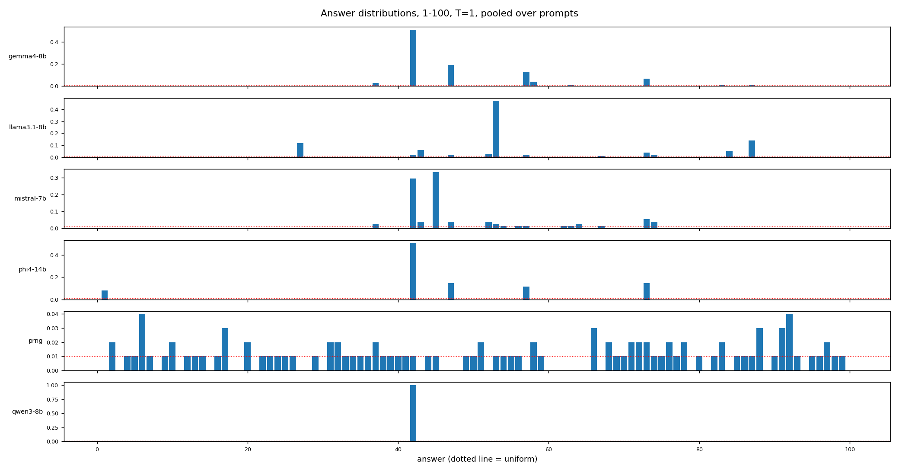
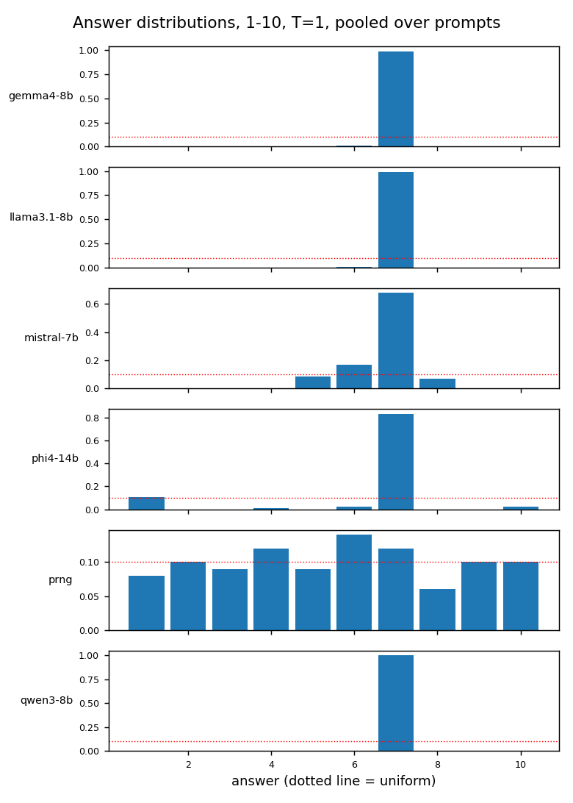
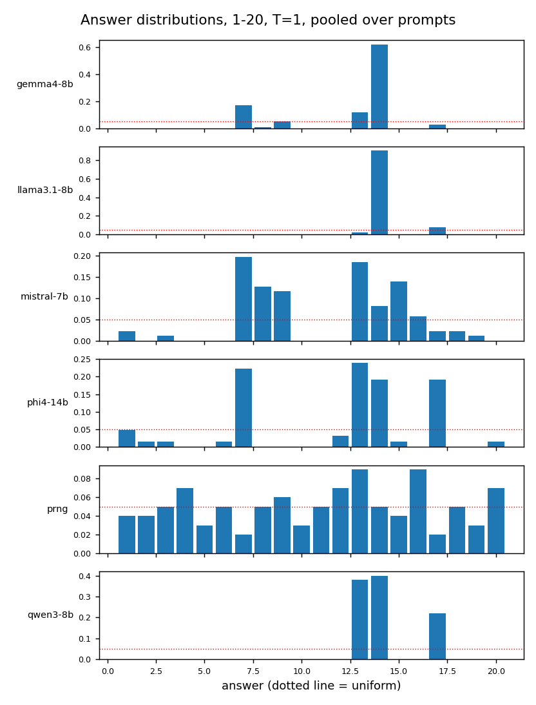
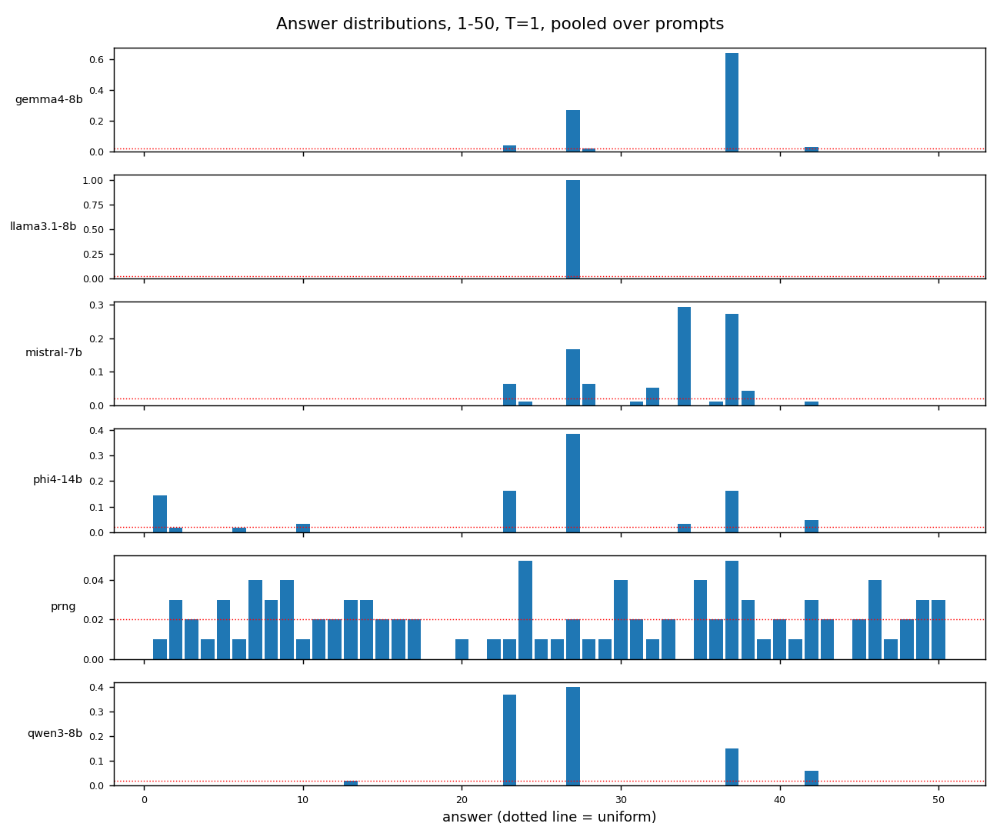
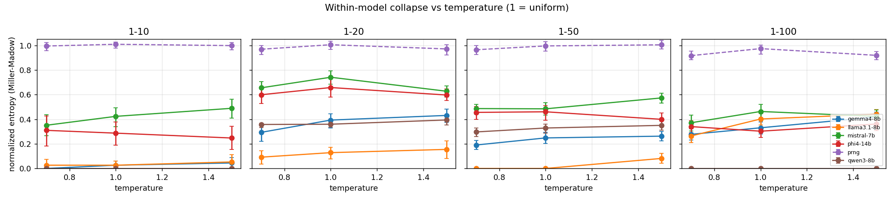
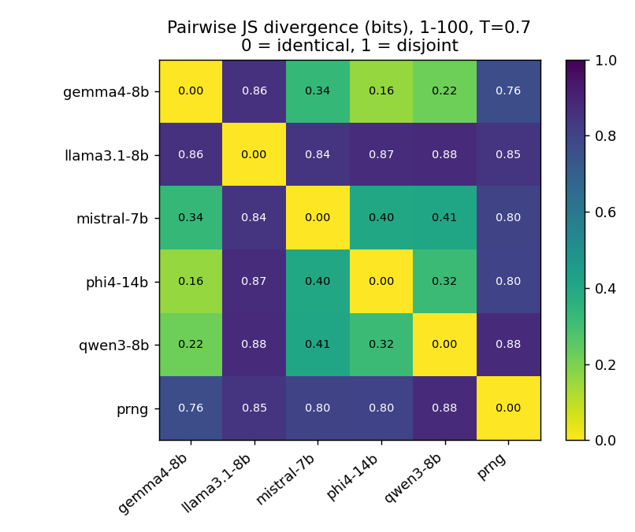
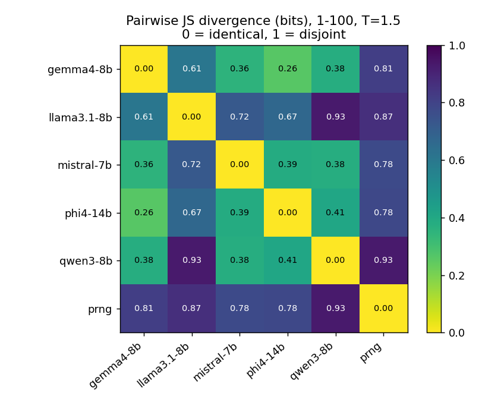
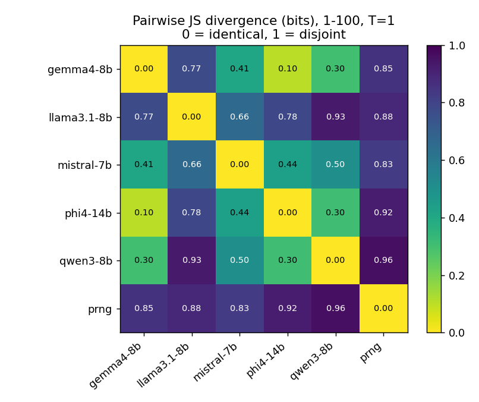
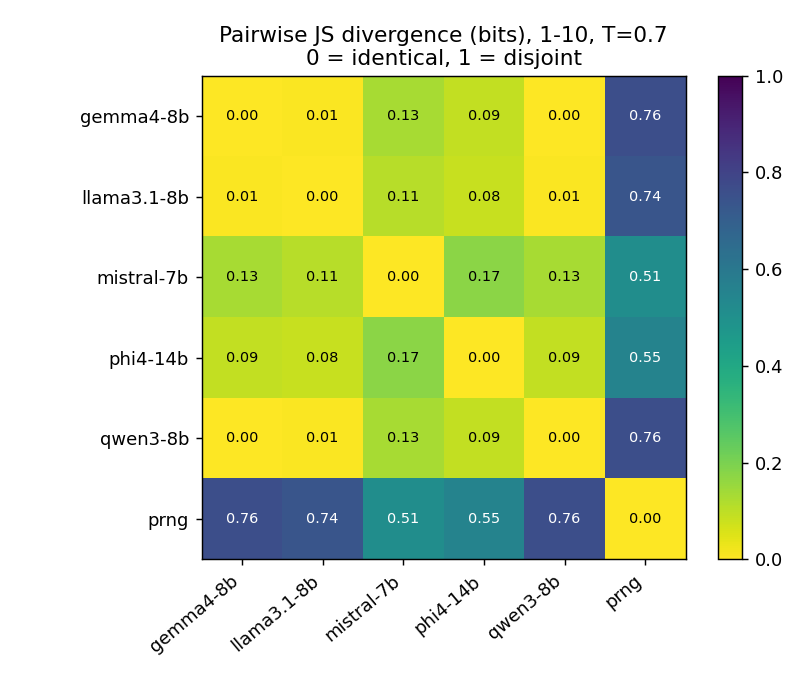
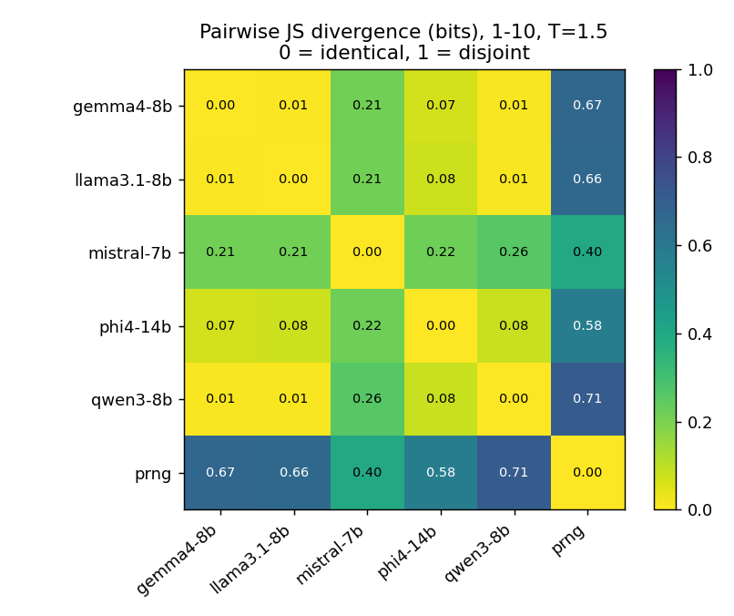
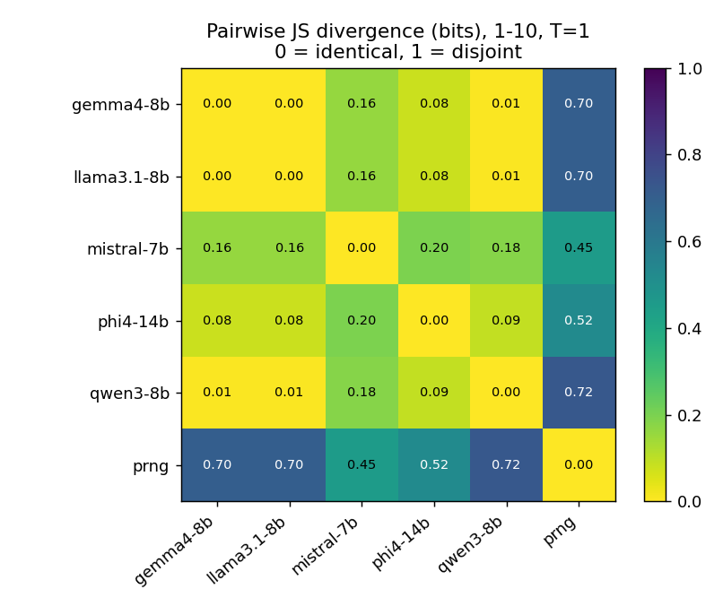
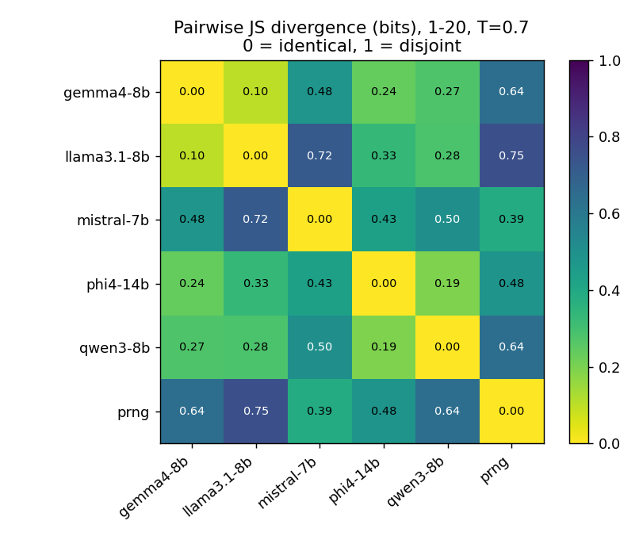
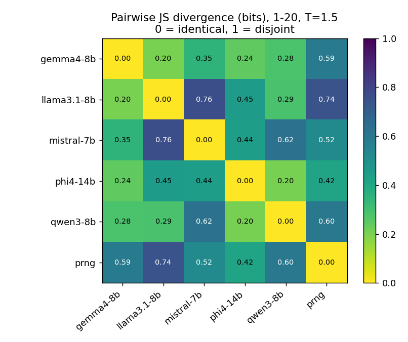
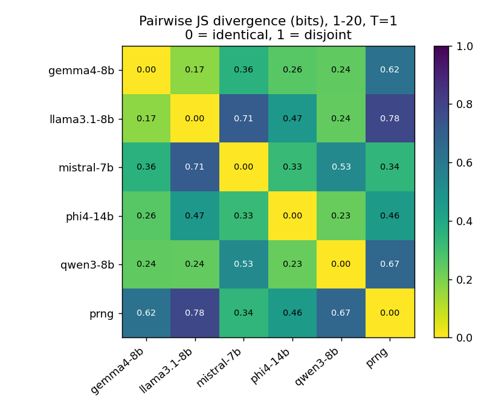
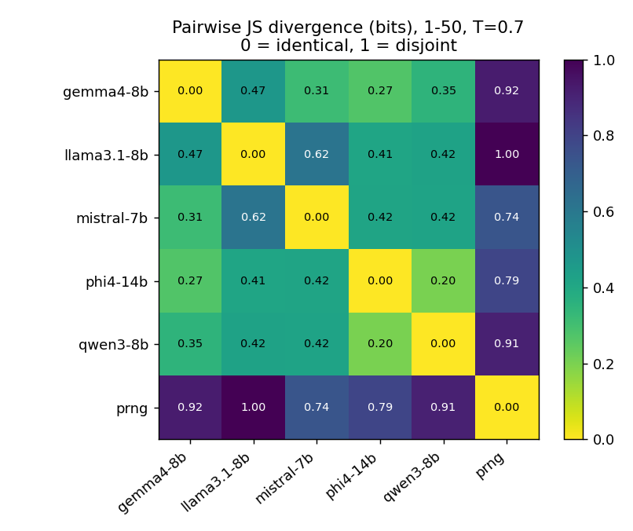
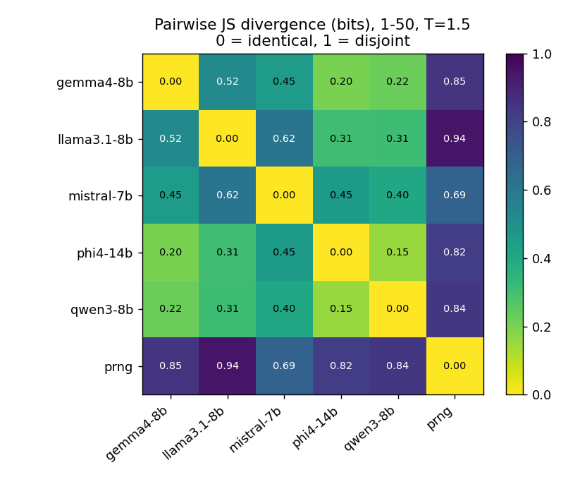
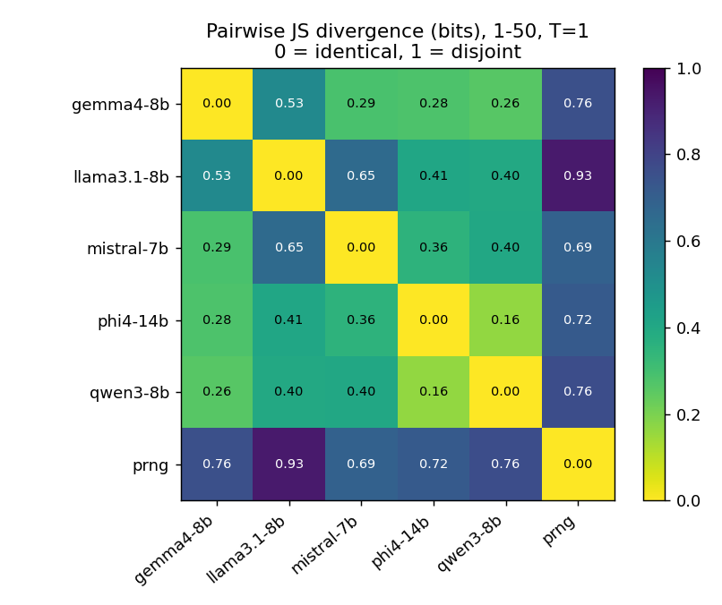

## Boundary

This measures correlated predictability in one toy generative choice. It does not measure whether model judgment, classification or triage converges; that argument rests on the cited literature on cross-model transferability, not on these runs.