# Everyone Picks Seven: summary (20261014-020315)

Responses scored: 72600. Manifest sha256: `c8ff6452a455a6b882a1db0e9f836f7c5beb8ca42bce373d88976a2e449ff9c3`.

**Collapse** is within-model: how far one model's answer distribution sits from uniform. **Correlated collapse** is across-model: how much the collapsed distributions agree with each other. The independent-bias null keeps each model's collapse exactly and destroys only the cross-model alignment, so the gap between observed and null is the correlated part alone.

## Headline: correlated collapse vs the independent-bias null

| range | T | mean pairwise JS (observed) | null mean JS | null 1st pct | p (one-sided) | shared mode rate (obs / null) | global guess | hit global (LOO) | hit oracle | uniform |
|---|---|---|---|---|---|---|---|---|---|---|
| **1-10** | **0.7** | 0.076 | 0.866 | 0.755 | 0.0005 | 1.00 / 0.10 | 7 | 0.866 (0.866) | 0.866 | 0.100 |
| **1-10** | **1** | 0.103 | 0.858 | 0.757 | 0.0005 | 1.00 / 0.10 | 7 | 0.843 (0.843) | 0.843 | 0.100 |
| 1-10 | 1.5 | 0.136 | 0.844 | 0.744 | 0.0005 | 1.00 / 0.10 | 7 | 0.811 (0.811) | 0.811 | 0.100 |
| **1-20** | **0.7** | 0.480 | 0.869 | 0.798 | 0.0005 | 0.34 / 0.05 | 14 | 0.474 (0.474) | 0.508 | 0.050 |
| **1-20** | **1** | 0.467 | 0.856 | 0.790 | 0.0005 | 0.26 / 0.05 | 14 | 0.433 (0.433) | 0.462 | 0.050 |
| 1-20 | 1.5 | 0.489 | 0.844 | 0.776 | 0.0005 | 0.24 / 0.05 | 14 | 0.393 (0.393) | 0.443 | 0.050 |
| **1-50** | **0.7** | 0.470 | 0.951 | 0.901 | 0.0005 | 0.28 / 0.02 | 27 | 0.424 (0.227) | 0.542 | 0.020 |
| **1-50** | **1** | 0.470 | 0.944 | 0.894 | 0.0005 | 0.28 / 0.02 | 27 | 0.413 (0.218) | 0.523 | 0.020 |
| 1-50 | 1.5 | 0.461 | 0.932 | 0.886 | 0.0005 | 0.26 / 0.02 | 27 | 0.383 (0.200) | 0.464 | 0.020 |
| **1-100** | **0.7** | 0.630 | 0.972 | 0.935 | 0.0005 | 0.34 / 0.01 | 42 | 0.434 (0.434) | 0.558 | 0.010 |
| **1-100** | **1** | 0.610 | 0.964 | 0.929 | 0.0005 | 0.28 / 0.01 | 42 | 0.412 (0.412) | 0.510 | 0.010 |
| 1-100 | 1.5 | 0.590 | 0.958 | 0.923 | 0.0005 | 0.28 / 0.01 | 42 | 0.402 (0.402) | 0.468 | 0.010 |

Observed JS and the null are means over the five prompts (per-prompt distributions, permuted independently per model and per prompt). Hit rates use distributions pooled over prompts; LOO = the global guess is chosen from the other models and scored on the held-out one. p-values are bounded below by 1/(reps+1) = 0.0005.

## Predeclared hypotheses

- **H1 HELD**: Mean model normalized entropy < 0.75 at headline temperatures, and lowest at the lowest sampled temperature
  - `{"mean_normalized_entropy": {"r10_t0.7": 0.116, "r10_t1": 0.144, "r10_t1.5": 0.18, "r20_t0.7": 0.393, "r20_t1": 0.429, "r20_t1.5": 0.456, "r50_t0.7": 0.275, "r50_t1": 0.303, "r50_t1.5": 0.35, "r100_t0.7": 0.27, "r100_t1": 0.309, "r100_t1.5": 0.345}, "below_threshold": true, "lowest_at_low_T": true}`
- **H2 HELD**: 7 is the mode in 1-10 for a majority of model families at T=1
  - `{"modes": {"llama3.1-8b": 7, "qwen3-8b": 7, "mistral-7b": 7, "gemma4-8b": 7, "phi4-14b": 7}, "families_with_mode_7": 5}`
- **H3 HELD**: Mean pairwise JS far below the independent-bias null (one-sided p < 0.01) at every range and headline temperature
  - `{"r10_t0.7": {"observed": 0.0764, "null_mean": 0.8659, "p": 0.0004997501249375312}, "r10_t1": {"observed": 0.1034, "null_mean": 0.8577, "p": 0.0004997501249375312}, "r20_t0.7": {"observed": 0.4799, "null_mean": 0.8686, "p": 0.0004997501249375312}, "r20_t1": {"observed": 0.4674, "null_mean": 0.8563, "p": 0.0004997501249375312}, "r50_t0.7": {"observed": 0.4699, "null_mean": 0.9506, "p": 0.0004997501249375312}, "r50_t1": {"observed": 0.4705, "null_mean": 0.9436, "p": 0.0004997501249375312}, "r100_t0.7": {"observed": 0.6301, "null_mean": 0.9724, "p": 0.0004997501249375312}, "r100_t1": {"observed": 0.6097, "null_mean": 0.9644, "p": 0.0004997501249375312}}`
- **H4 HELD**: Leave-one-model-out global single-guess hit rate >= 3.0x uniform at every range and headline temperature
  - `{"r10_t0.7": {"global_loo": 0.866, "uniform": 0.1, "multiple": 8.66}, "r10_t1": {"global_loo": 0.8426, "uniform": 0.1, "multiple": 8.43}, "r20_t0.7": {"global_loo": 0.4736, "uniform": 0.05, "multiple": 9.47}, "r20_t1": {"global_loo": 0.4332, "uniform": 0.05, "multiple": 8.66}, "r50_t0.7": {"global_loo": 0.2268, "uniform": 0.02, "multiple": 11.34}, "r50_t1": {"global_loo": 0.2178, "uniform": 0.02, "multiple": 10.89}, "r100_t0.7": {"global_loo": 0.4344, "uniform": 0.01, "multiple": 43.44}, "r100_t1": {"global_loo": 0.4124, "uniform": 0.01, "multiple": 41.24}}`

## Parse-rule sensitivity (lenient: first in-range integer)

| range | T | observed JS (strict / lenient) | null JS (strict / lenient) | p (strict / lenient) |
|---|---|---|---|---|
| 1-10 | 0.7 | 0.076 / 0.109 | 0.866 / 0.858 | 0.0005 / 0.0005 |
| 1-10 | 1 | 0.103 / 0.137 | 0.858 / 0.848 | 0.0005 / 0.0005 |
| 1-10 | 1.5 | 0.136 / 0.168 | 0.844 / 0.836 | 0.0005 / 0.0005 |
| 1-20 | 0.7 | 0.480 / 0.502 | 0.869 / 0.864 | 0.0005 / 0.0005 |
| 1-20 | 1 | 0.467 / 0.490 | 0.856 / 0.852 | 0.0005 / 0.0005 |
| 1-20 | 1.5 | 0.489 / 0.508 | 0.844 / 0.841 | 0.0005 / 0.0005 |
| 1-50 | 0.7 | 0.470 / 0.480 | 0.951 / 0.947 | 0.0005 / 0.0005 |
| 1-50 | 1 | 0.470 / 0.481 | 0.944 / 0.941 | 0.0005 / 0.0005 |
| 1-50 | 1.5 | 0.461 / 0.470 | 0.932 / 0.929 | 0.0005 / 0.0005 |
| 1-100 | 0.7 | 0.630 / 0.648 | 0.972 / 0.971 | 0.0005 / 0.0005 |
| 1-100 | 1 | 0.610 / 0.633 | 0.964 / 0.962 | 0.0005 / 0.0005 |
| 1-100 | 1.5 | 0.590 / 0.606 | 0.958 / 0.956 | 0.0005 / 0.0005 |

Hypotheses under the lenient rule: H1 held, H2 held, H3 held, H4 held

## Within-model collapse (pooled over prompts)

| respondent | range | T | norm. entropy [95% CI] | mode | p_mode | top3 | top3 mass | parse fail |
|---|---|---|---|---|---|---|---|---|
| gemma4-8b | 1-10 | 0.7 | 0.012 [0.004, 0.020] | 7 | 0.996 | [7, 6, 1] | 1.000 | 0.000 |
| llama3.1-8b | 1-10 | 0.7 | 0.018 [0.006, 0.028] | 7 | 0.993 | [7, 6, 1] | 1.000 | 0.000 |
| mistral-7b | 1-10 | 0.7 | 0.339 [0.308, 0.369] | 7 | 0.672 | [7, 6, 5] | 0.843 | 0.130 |
| phi4-14b | 1-10 | 0.7 | 0.212 [0.179, 0.245] | 7 | 0.669 | [7, 1, 10] | 0.738 | 0.244 |
| prng | 1-10 | 0.7 | 1.000 [0.997, 1.003] | 8 | 0.111 | [8, 7, 2] | 0.326 | 0.000 |
| qwen3-8b | 1-10 | 0.7 | 0.000 [0.000, 0.000] | 7 | 1.000 | [7, 1, 2] | 1.000 | 0.000 |
| gemma4-8b | 1-10 | 1 | 0.018 [0.006, 0.028] | 7 | 0.993 | [7, 6, 1] | 1.000 | 0.000 |
| llama3.1-8b | 1-10 | 1 | 0.036 [0.023, 0.051] | 7 | 0.984 | [7, 6, 1] | 1.000 | 0.000 |
| mistral-7b | 1-10 | 1 | 0.430 [0.402, 0.456] | 7 | 0.589 | [7, 6, 5] | 0.830 | 0.125 |
| phi4-14b | 1-10 | 1 | 0.238 [0.202, 0.273] | 7 | 0.648 | [7, 1, 6] | 0.717 | 0.258 |
| prng | 1-10 | 1 | 1.001 [0.997, 1.003] | 8 | 0.115 | [8, 3, 4] | 0.330 | 0.000 |
| qwen3-8b | 1-10 | 1 | 0.000 [0.000, 0.000] | 7 | 0.999 | [7, 1, 2] | 0.999 | 0.001 |
| gemma4-8b | 1-10 | 1.5 | 0.041 [0.027, 0.054] | 7 | 0.981 | [7, 6, 1] | 1.000 | 0.000 |
| llama3.1-8b | 1-10 | 1.5 | 0.084 [0.066, 0.104] | 7 | 0.957 | [7, 6, 5] | 0.999 | 0.000 |
| mistral-7b | 1-10 | 1.5 | 0.525 [0.500, 0.549] | 7 | 0.491 | [7, 6, 5] | 0.797 | 0.123 |
| phi4-14b | 1-10 | 1.5 | 0.243 [0.206, 0.277] | 7 | 0.630 | [7, 1, 10] | 0.705 | 0.274 |
| prng | 1-10 | 1.5 | 1.001 [0.998, 1.003] | 10 | 0.106 | [10, 8, 5] | 0.315 | 0.000 |
| qwen3-8b | 1-10 | 1.5 | 0.006 [0.000, 0.014] | 7 | 0.998 | [7, 5, 1] | 1.000 | 0.000 |
| gemma4-8b | 1-20 | 0.7 | 0.276 [0.253, 0.297] | 14 | 0.755 | [14, 13, 7] | 0.969 | 0.000 |
| llama3.1-8b | 1-20 | 0.7 | 0.075 [0.058, 0.090] | 14 | 0.955 | [14, 17, 13] | 0.997 | 0.000 |
| mistral-7b | 1-20 | 0.7 | 0.639 [0.622, 0.653] | 13 | 0.220 | [13, 7, 8] | 0.550 | 0.121 |
| phi4-14b | 1-20 | 0.7 | 0.620 [0.599, 0.640] | 14 | 0.203 | [14, 13, 1] | 0.456 | 0.326 |
| prng | 1-20 | 0.7 | 1.000 [0.996, 1.003] | 9 | 0.064 | [9, 20, 4] | 0.185 | 0.000 |
| qwen3-8b | 1-20 | 0.7 | 0.355 [0.350, 0.360] | 14 | 0.405 | [14, 13, 17] | 1.000 | 0.000 |
| gemma4-8b | 1-20 | 1 | 0.364 [0.344, 0.385] | 14 | 0.648 | [14, 7, 13] | 0.934 | 0.000 |
| llama3.1-8b | 1-20 | 1 | 0.134 [0.116, 0.152] | 14 | 0.906 | [14, 17, 13] | 0.992 | 0.000 |
| mistral-7b | 1-20 | 1 | 0.670 [0.654, 0.684] | 7 | 0.191 | [7, 13, 8] | 0.529 | 0.099 |
| phi4-14b | 1-20 | 1 | 0.621 [0.602, 0.639] | 13 | 0.172 | [13, 14, 1] | 0.428 | 0.333 |
| prng | 1-20 | 1 | 1.000 [0.996, 1.003] | 1 | 0.064 | [1, 20, 8] | 0.190 | 0.000 |
| qwen3-8b | 1-20 | 1 | 0.358 [0.353, 0.362] | 14 | 0.391 | [14, 13, 17] | 1.000 | 0.000 |
| gemma4-8b | 1-20 | 1.5 | 0.424 [0.406, 0.442] | 14 | 0.539 | [14, 13, 7] | 0.911 | 0.000 |
| llama3.1-8b | 1-20 | 1.5 | 0.159 [0.137, 0.181] | 14 | 0.890 | [14, 13, 17] | 0.987 | 0.000 |
| mistral-7b | 1-20 | 1.5 | 0.666 [0.648, 0.682] | 7 | 0.222 | [7, 8, 9] | 0.532 | 0.116 |
| phi4-14b | 1-20 | 1.5 | 0.655 [0.635, 0.675] | 13 | 0.151 | [13, 1, 14] | 0.404 | 0.325 |
| prng | 1-20 | 1.5 | 1.001 [0.997, 1.003] | 5 | 0.061 | [5, 6, 11] | 0.175 | 0.000 |
| qwen3-8b | 1-20 | 1.5 | 0.377 [0.367, 0.385] | 13 | 0.414 | [13, 14, 17] | 0.986 | 0.000 |
| gemma4-8b | 1-50 | 0.7 | 0.185 [0.173, 0.198] | 37 | 0.700 | [37, 27, 42] | 0.991 | 0.000 |
| llama3.1-8b | 1-50 | 0.7 | 0.018 [0.010, 0.027] | 27 | 0.988 | [27, 23, 37] | 1.000 | 0.000 |
| mistral-7b | 1-50 | 0.7 | 0.449 [0.432, 0.465] | 34 | 0.284 | [34, 37, 27] | 0.701 | 0.102 |
| phi4-14b | 1-50 | 0.7 | 0.416 [0.395, 0.437] | 27 | 0.312 | [27, 37, 23] | 0.540 | 0.303 |
| prng | 1-50 | 0.7 | 1.000 [0.995, 1.004] | 36 | 0.030 | [36, 43, 4] | 0.087 | 0.000 |
| qwen3-8b | 1-50 | 0.7 | 0.308 [0.297, 0.318] | 23 | 0.424 | [23, 27, 37] | 0.952 | 0.000 |
| gemma4-8b | 1-50 | 1 | 0.224 [0.210, 0.236] | 37 | 0.670 | [37, 27, 42] | 0.971 | 0.000 |
| llama3.1-8b | 1-50 | 1 | 0.029 [0.019, 0.039] | 27 | 0.978 | [27, 23, 25] | 0.999 | 0.000 |
| mistral-7b | 1-50 | 1 | 0.504 [0.488, 0.520] | 34 | 0.264 | [34, 37, 27] | 0.647 | 0.084 |
| phi4-14b | 1-50 | 1 | 0.433 [0.415, 0.452] | 27 | 0.289 | [27, 37, 23] | 0.521 | 0.307 |
| prng | 1-50 | 1 | 0.999 [0.994, 1.003] | 31 | 0.032 | [31, 42, 3] | 0.092 | 0.000 |
| qwen3-8b | 1-50 | 1 | 0.324 [0.313, 0.335] | 23 | 0.412 | [23, 27, 37] | 0.927 | 0.000 |
| gemma4-8b | 1-50 | 1.5 | 0.271 [0.258, 0.284] | 37 | 0.599 | [37, 27, 42] | 0.933 | 0.000 |
| llama3.1-8b | 1-50 | 1.5 | 0.088 [0.075, 0.103] | 27 | 0.919 | [27, 23, 25] | 0.992 | 0.001 |
| mistral-7b | 1-50 | 1.5 | 0.573 [0.557, 0.587] | 34 | 0.190 | [34, 37, 27] | 0.511 | 0.101 |
| phi4-14b | 1-50 | 1.5 | 0.471 [0.453, 0.489] | 27 | 0.221 | [27, 1, 37] | 0.478 | 0.311 |
| prng | 1-50 | 1.5 | 1.001 [0.997, 1.005] | 28 | 0.029 | [28, 7, 45] | 0.080 | 0.000 |
| qwen3-8b | 1-50 | 1.5 | 0.347 [0.335, 0.359] | 23 | 0.393 | [23, 27, 37] | 0.900 | 0.000 |
| gemma4-8b | 1-100 | 0.7 | 0.270 [0.255, 0.283] | 42 | 0.587 | [42, 47, 57] | 0.883 | 0.000 |
| llama3.1-8b | 1-100 | 0.7 | 0.299 [0.281, 0.317] | 53 | 0.626 | [53, 87, 27] | 0.847 | 0.003 |
| mistral-7b | 1-100 | 0.7 | 0.438 [0.419, 0.456] | 45 | 0.281 | [45, 42, 47] | 0.617 | 0.159 |
| phi4-14b | 1-100 | 0.7 | 0.344 [0.326, 0.360] | 42 | 0.298 | [42, 73, 47] | 0.491 | 0.373 |
| prng | 1-100 | 0.7 | 1.002 [0.997, 1.007] | 16 | 0.020 | [16, 41, 98] | 0.054 | 0.000 |
| qwen3-8b | 1-100 | 0.7 | 0.000 [0.000, 0.000] | 42 | 1.000 | [42, 1, 2] | 1.000 | 0.000 |
| gemma4-8b | 1-100 | 1 | 0.335 [0.320, 0.349] | 42 | 0.503 | [42, 47, 73] | 0.794 | 0.000 |
| llama3.1-8b | 1-100 | 1 | 0.380 [0.363, 0.398] | 53 | 0.514 | [53, 87, 27] | 0.726 | 0.002 |
| mistral-7b | 1-100 | 1 | 0.492 [0.472, 0.512] | 45 | 0.253 | [45, 42, 47] | 0.547 | 0.156 |
| phi4-14b | 1-100 | 1 | 0.337 [0.319, 0.353] | 42 | 0.282 | [42, 1, 47] | 0.470 | 0.393 |
| prng | 1-100 | 1 | 1.002 [0.997, 1.006] | 85 | 0.020 | [85, 16, 86] | 0.052 | 0.000 |
| qwen3-8b | 1-100 | 1 | 0.000 [0.000, 0.000] | 42 | 1.000 | [42, 1, 2] | 1.000 | 0.000 |
| gemma4-8b | 1-100 | 1.5 | 0.386 [0.372, 0.400] | 42 | 0.437 | [42, 47, 73] | 0.724 | 0.000 |
| llama3.1-8b | 1-100 | 1.5 | 0.450 [0.437, 0.465] | 53 | 0.386 | [53, 87, 27] | 0.615 | 0.002 |
| mistral-7b | 1-100 | 1.5 | 0.509 [0.489, 0.527] | 42 | 0.260 | [42, 45, 47] | 0.537 | 0.139 |
| phi4-14b | 1-100 | 1.5 | 0.377 [0.358, 0.393] | 42 | 0.261 | [42, 1, 47] | 0.469 | 0.366 |
| prng | 1-100 | 1.5 | 0.997 [0.992, 1.002] | 4 | 0.020 | [4, 69, 76] | 0.054 | 0.000 |
| qwen3-8b | 1-100 | 1.5 | 0.003 [0.000, 0.007] | 42 | 0.998 | [42, 37, 1] | 1.000 | 0.000 |

## Per-prompt spread of cross-model agreement

| range | T | mean JS: mean ± sd [min, max] over prompts | shared mode rate: mean [min, max] |
|---|---|---|---|
| 1-10 | 0.7 | 0.076 ± 0.035 [0.039, 0.134] | 1.00 [1.00, 1.00] |
| 1-10 | 1 | 0.103 ± 0.037 [0.055, 0.157] | 1.00 [1.00, 1.00] |
| 1-10 | 1.5 | 0.136 ± 0.036 [0.093, 0.191] | 1.00 [1.00, 1.00] |
| 1-20 | 0.7 | 0.480 ± 0.109 [0.320, 0.578] | 0.34 [0.20, 0.60] |
| 1-20 | 1 | 0.467 ± 0.085 [0.342, 0.540] | 0.26 [0.10, 0.60] |
| 1-20 | 1.5 | 0.489 ± 0.109 [0.307, 0.580] | 0.24 [0.10, 0.60] |
| 1-50 | 0.7 | 0.470 ± 0.166 [0.308, 0.750] | 0.28 [0.10, 0.60] |
| 1-50 | 1 | 0.470 ± 0.155 [0.309, 0.727] | 0.28 [0.10, 0.60] |
| 1-50 | 1.5 | 0.461 ± 0.140 [0.296, 0.682] | 0.26 [0.10, 0.60] |
| 1-100 | 0.7 | 0.630 ± 0.120 [0.434, 0.741] | 0.34 [0.10, 0.60] |
| 1-100 | 1 | 0.610 ± 0.126 [0.402, 0.732] | 0.28 [0.10, 0.60] |
| 1-100 | 1.5 | 0.590 ± 0.117 [0.409, 0.714] | 0.28 [0.10, 0.60] |

## Greedy answers (T = 0)

| range | prompt | llama3.1-8b | qwen3-8b | mistral-7b | gemma4-8b | phi4-14b | most common | share |
|---|---|---|---|---|---|---|---|---|
| 1-10 | p1 | 7 | 7 | 7 | 7 | 7 | 7 | 1.00 |
| 1-10 | p2 | 7 | 7 | 7 | 7 | None | 7 | 0.80 |
| 1-10 | p3 | 7 | 7 | 7 | 7 | 7 | 7 | 1.00 |
| 1-10 | p4 | 7 | 7 | 7 | 7 | None | 7 | 0.80 |
| 1-10 | p5 | 7 | 7 | None | 7 | 7 | 7 | 0.80 |
| 1-20 | p1 | 14 | 13 | 13 | 14 | 13 | 13 | 0.60 |
| 1-20 | p2 | 14 | 13 | 13 | 14 | 14 | 14 | 0.60 |
| 1-20 | p3 | 14 | 14 | 13 | 14 | 14 | 14 | 0.80 |
| 1-20 | p4 | 14 | 13 | 8 | 14 | None | 14 | 0.40 |
| 1-20 | p5 | 14 | 17 | 13 | 14 | 17 | 17 | 0.40 |
| 1-50 | p1 | 27 | 23 | 34 | 37 | 27 | 27 | 0.40 |
| 1-50 | p2 | 27 | 23 | 37 | 37 | 27 | 27 | 0.40 |
| 1-50 | p3 | 27 | 27 | 34 | 37 | 27 | 27 | 0.60 |
| 1-50 | p4 | 27 | 23 | None | 27 | 50 | 27 | 0.40 |
| 1-50 | p5 | 27 | 37 | 37 | 37 | 37 | 37 | 0.80 |
| 1-100 | p1 | 53 | 42 | 42 | 42 | None | 42 | 0.60 |
| 1-100 | p2 | 53 | 42 | 56 | 42 | 42 | 42 | 0.60 |
| 1-100 | p3 | 53 | 42 | None | 42 | 42 | 42 | 0.60 |
| 1-100 | p4 | 53 | 42 | 42 | 47 | None | 42 | 0.40 |
| 1-100 | p5 | 87 | 42 | 47 | 42 | None | 42 | 0.40 |

## Integrity

- Sample counts: OK (480 cells, exact predeclared counts).
- Uniform control: 12/12 (range, T) cells pass (entropy at or above the simulated true-uniform 0.1th percentile at the same sample size; zero parse failures). Lowest: 0.997.
  - 1-10 T=0.7: min JS(control, model) 0.505 vs uniform-vs-uniform 99.9th pct 0.012: separated from every model; mean model-model JS (pooled) 0.066
  - 1-10 T=1: min JS(control, model) 0.479 vs uniform-vs-uniform 99.9th pct 0.013: separated from every model; mean model-model JS (pooled) 0.088
  - 1-10 T=1.5: min JS(control, model) 0.421 vs uniform-vs-uniform 99.9th pct 0.013: separated from every model (not enforced at this T); mean model-model JS (pooled) 0.114
  - 1-20 T=0.7: min JS(control, model) 0.431 vs uniform-vs-uniform 99.9th pct 0.020: separated from every model; mean model-model JS (pooled) 0.364
  - 1-20 T=1: min JS(control, model) 0.401 vs uniform-vs-uniform 99.9th pct 0.020: separated from every model; mean model-model JS (pooled) 0.346
  - 1-20 T=1.5: min JS(control, model) 0.396 vs uniform-vs-uniform 99.9th pct 0.019: separated from every model (not enforced at this T); mean model-model JS (pooled) 0.362
  - 1-50 T=0.7: min JS(control, model) 0.689 vs uniform-vs-uniform 99.9th pct 0.040: separated from every model; mean model-model JS (pooled) 0.371
  - 1-50 T=1: min JS(control, model) 0.655 vs uniform-vs-uniform 99.9th pct 0.038: separated from every model; mean model-model JS (pooled) 0.367
  - 1-50 T=1.5: min JS(control, model) 0.571 vs uniform-vs-uniform 99.9th pct 0.039: separated from every model (not enforced at this T); mean model-model JS (pooled) 0.357
  - 1-100 T=0.7: min JS(control, model) 0.716 vs uniform-vs-uniform 99.9th pct 0.073: separated from every model; mean model-model JS (pooled) 0.530
  - 1-100 T=1: min JS(control, model) 0.677 vs uniform-vs-uniform 99.9th pct 0.075: separated from every model; mean model-model JS (pooled) 0.510
  - 1-100 T=1.5: min JS(control, model) 0.646 vs uniform-vs-uniform 99.9th pct 0.071: separated from every model (not enforced at this T); mean model-model JS (pooled) 0.494
- Determinism at T=0 (cells with differing repeats / cells): {'llama3.1-8b': '2/20', 'qwen3-8b': '1/20', 'mistral-7b': '7/20', 'gemma4-8b': '1/20', 'phi4-14b': '4/20'}. Non-deterministic respondents: ['gemma4-8b', 'llama3.1-8b', 'mistral-7b', 'phi4-14b', 'qwen3-8b'].
- Parse failure reasons: `{"llama3.1-8b": {"no_number": 8}, "qwen3-8b": {"multiple_numbers": 1}, "mistral-7b": {"multiple_numbers": 1270, "out_of_range": 31, "no_number": 130, "non_integer": 24}, "phi4-14b": {"no_number": 1905, "multiple_numbers": 1889, "out_of_range": 16, "non_integer": 3}}`

## Figures

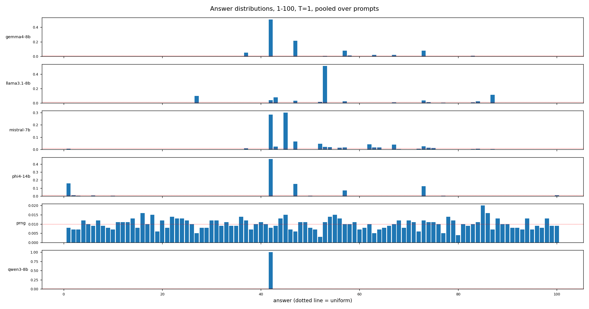
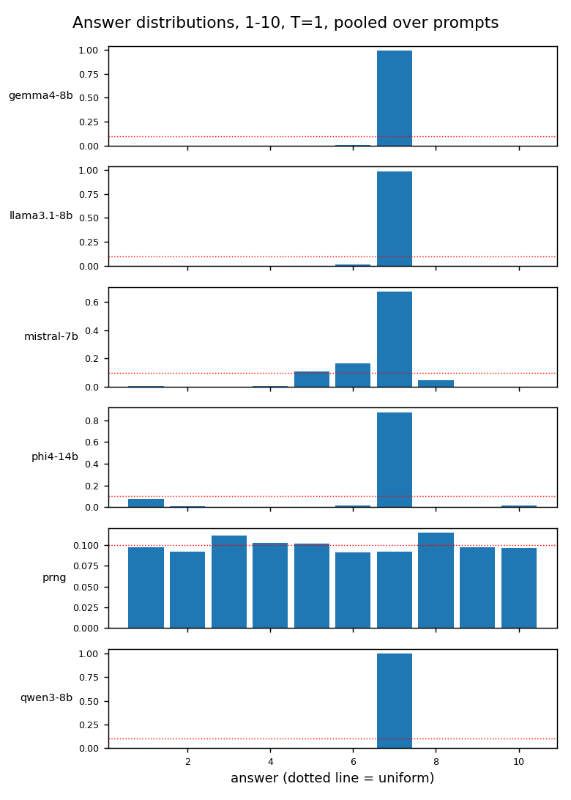
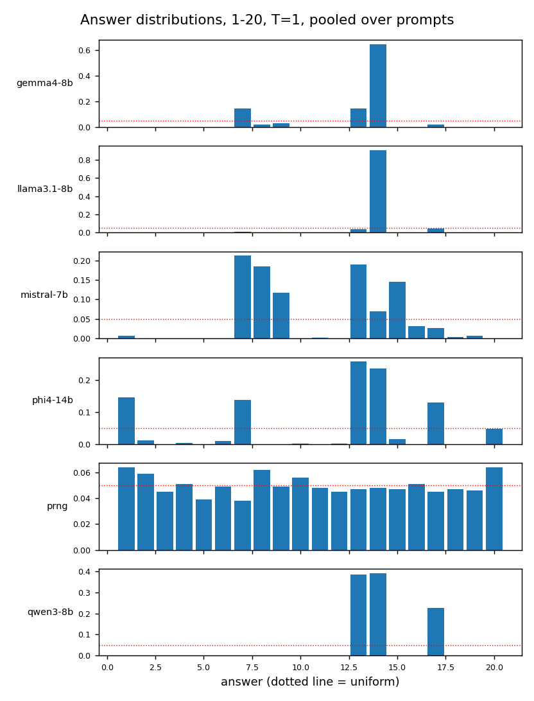
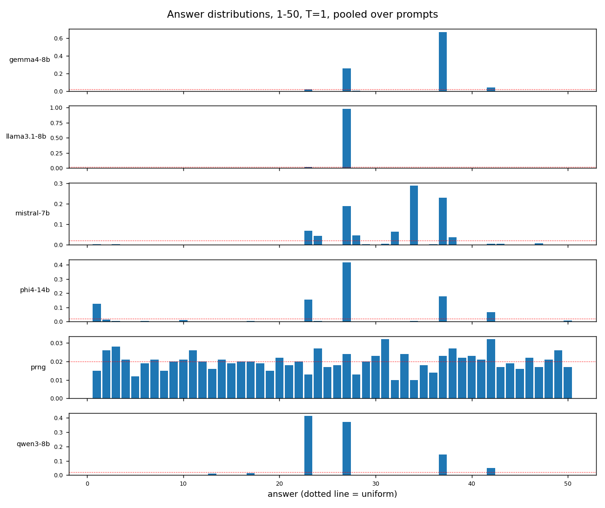
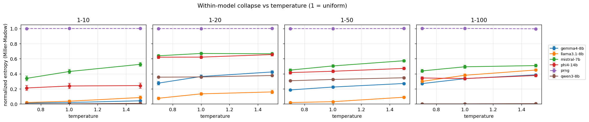
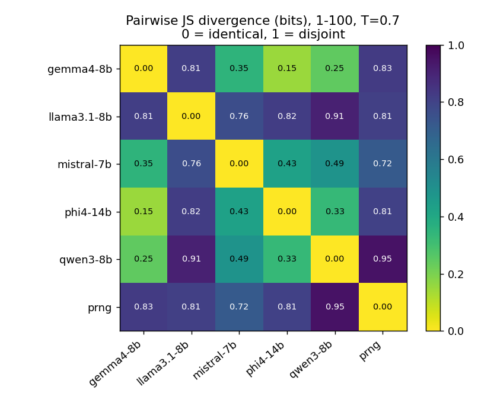
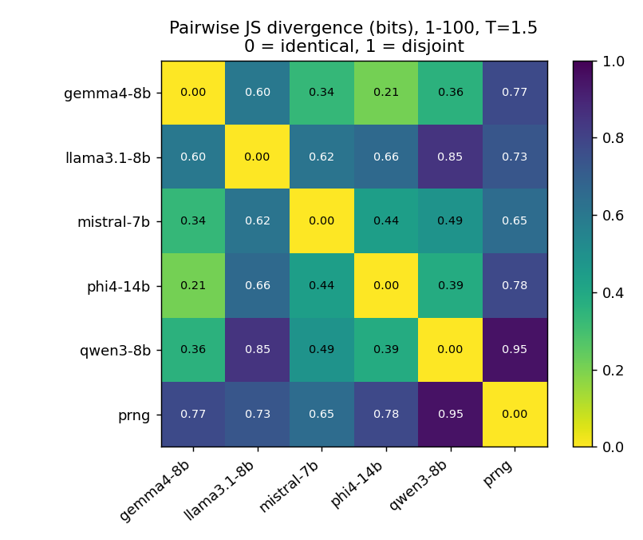
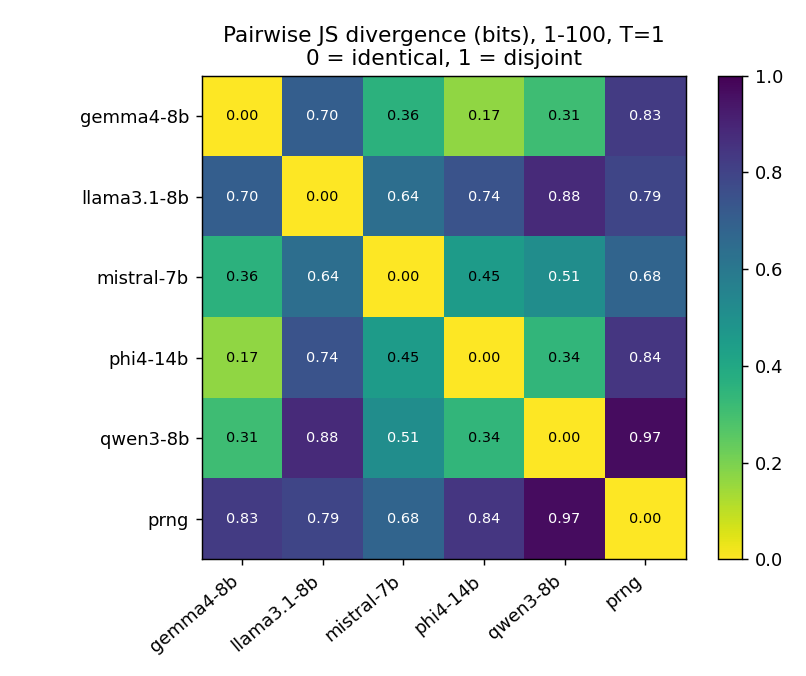
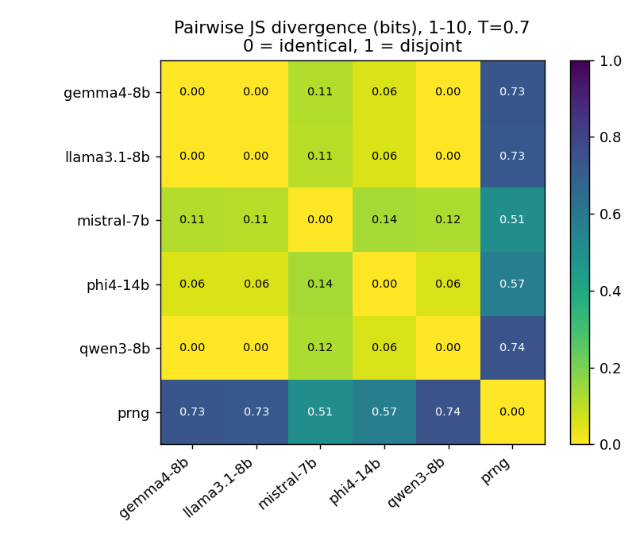
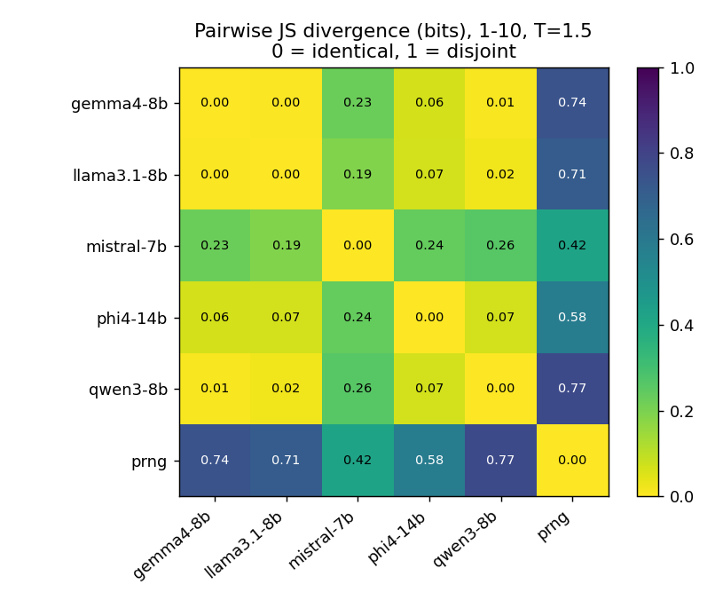
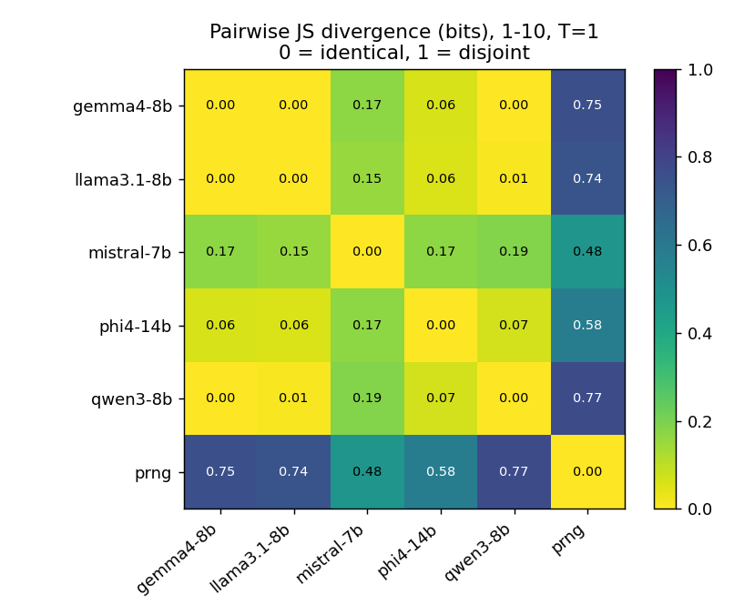
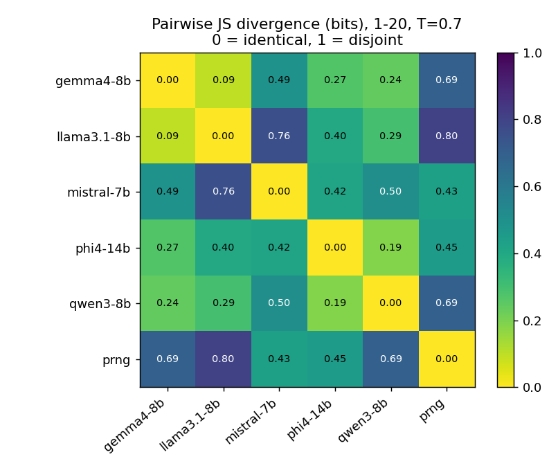

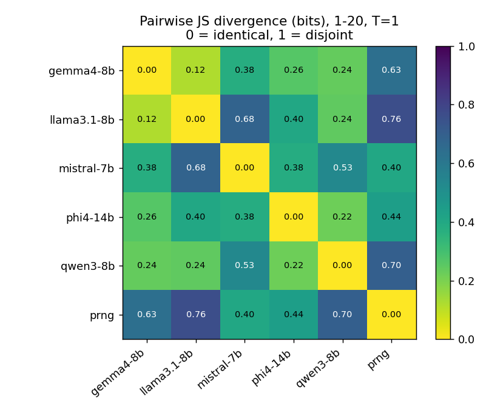
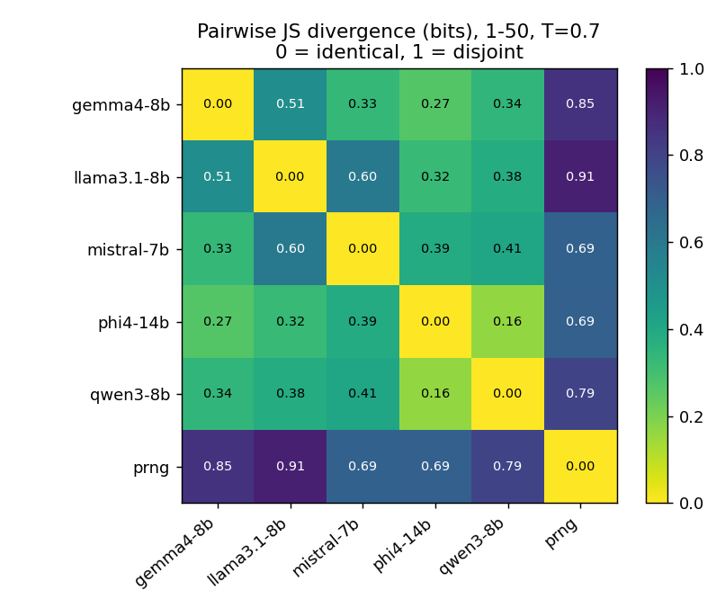
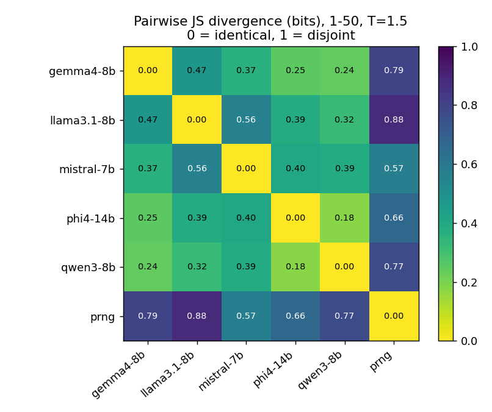

## Boundary

This measures correlated predictability in one toy generative choice. It does not measure whether model judgment, classification or triage converges; that argument rests on the cited literature on cross-model transferability, not on these runs.